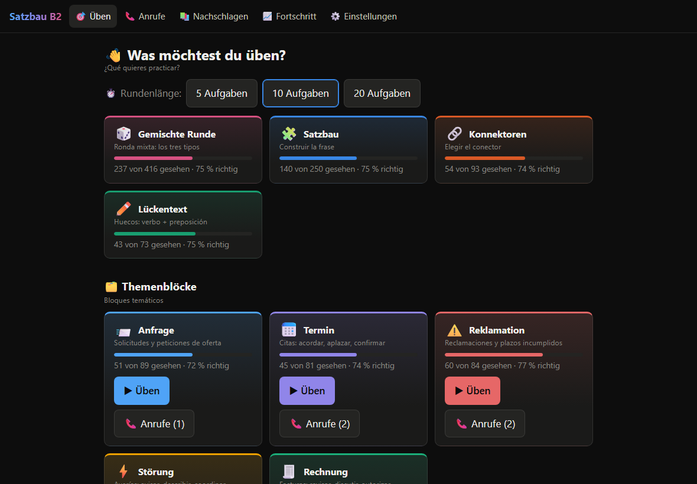
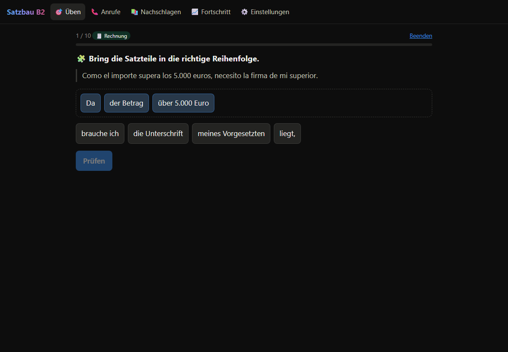
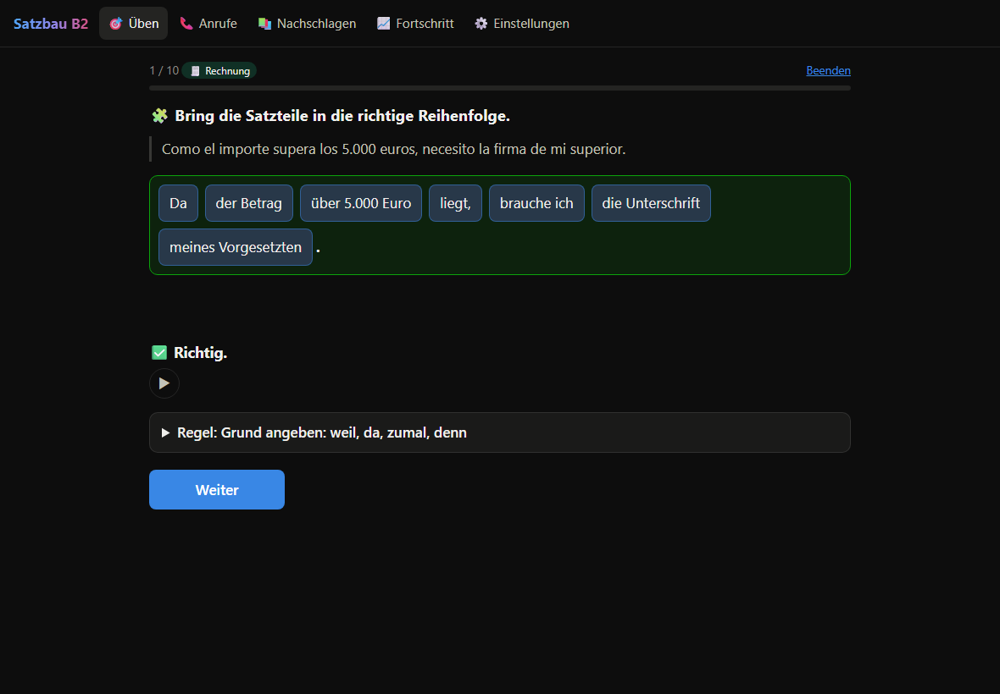
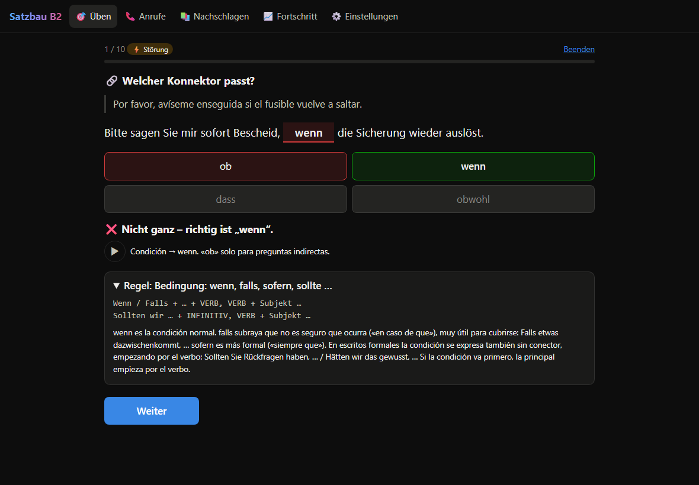
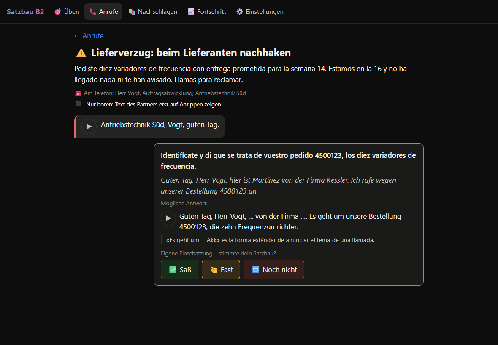
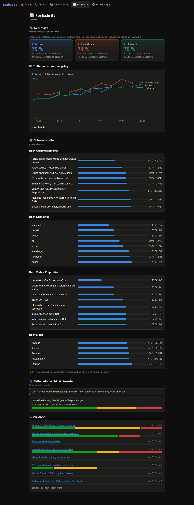
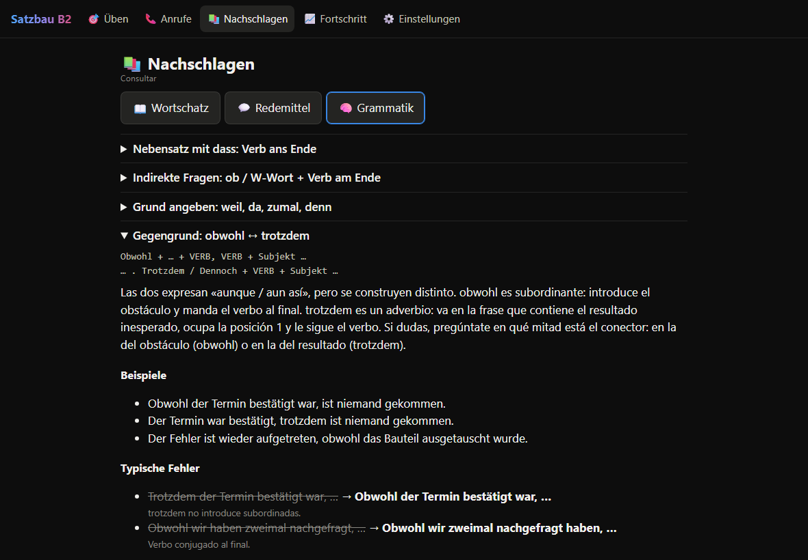
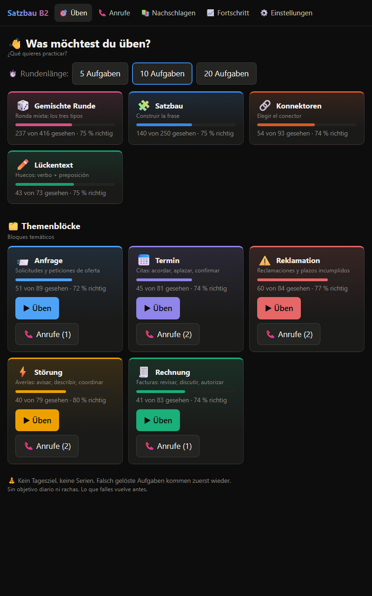

# 🧩 Satzbau B2 · Deutsch im Betrieb

**Entrenador de alemán B1 → B2 para el trabajo diario**: construir frases, conectores, verbos con
preposición fija y llamadas telefónicas con Dienstleister y otras Abteilungen.

👉 **Abrir la app: https://4ng318I.github.io/Deutsch_B2/**

Funciona en el ordenador y en la tablet, se instala como una app, va sin conexión y no necesita
cuenta. Rondas cortas de 5, 10 o 20 ejercicios: sin rachas, sin objetivos diarios y sin límites.

<p>
  
</p>

---

## Índice

- [Qué tiene](#qué-tiene)
- [Instalación](#instalación)
- [Cómo se usa](#cómo-se-usa)
- [Contenido](#contenido)
- [Lo que la app no hace](#lo-que-la-app-no-hace)
- [Para desarrollo](#para-desarrollo)

---

## Qué tiene

| | |
|---|---|
| 🧩 **Satzbau** | Ordenar las partes de una frase, sobre todo con el verbo al final. Se aceptan todos los órdenes correctos, no solo uno. |
| 🔗 **Konnektoren** | Una frase y cuatro conectores: weil, obwohl, damit, sodass, trotzdem, allerdings… |
| ✏️ **Lückentext** | La preposición fija que falta: sich beziehen **auf**, bestehen **aus**, sich kümmern **um**… |
| 📞 **Anrufe** | Llamadas simuladas. El interlocutor habla en voz alta y tú respondes. |
| 📚 **Nachschlagen** | Vocabulario por Abteilung, Redemittel por función y gramática explicada en español. |
| 📈 **Fortschritt** | Gráficas y dónde fallas: por regla gramatical, por conector, por verbo y por bloque. |

Los cinco bloques temáticos son 📨 Anfrage, 📅 Termin, ⚠️ Reklamation, ⚡ Störung y 🧾 Rechnung.

---

## Instalación

No hay que descargar nada de ninguna tienda. La primera vez se abre la página **con conexión**;
después funciona también sin internet.

### 📱 Tablet o móvil Android (Chrome)

1. Abre **https://4ng318I.github.io/Deutsch_B2/** en Chrome.
2. Pulsa el menú **⋮** (arriba a la derecha) y luego **Instalar aplicación**. En algunas versiones
   pone **Añadir a pantalla de inicio → Instalar**.
3. Aparece el icono **Satzbau B2** en la pantalla de inicio. Se abre a pantalla completa, como
   cualquier app.

**Voz alemana para las llamadas.** La app usa la voz del propio dispositivo. Si al pulsar ▶ no
suena nada o suena con acento español:

1. Ve a **Ajustes → Sistema → Idiomas → Salida de texto a voz**. El nombre exacto cambia según el
   fabricante; en Samsung está en *Administración general*.
2. Elige como motor **Servicios de voz de Google** y pulsa ⚙.
3. En **Instalar datos de voz**, instala **Deutsch (Deutschland)**.
4. En la app, en **⚙️ Einstellungen → Stimme**, elige la voz alemana y pulsa *Stimme testen*.

### 💻 Ordenador (Chrome o Edge)

1. Abre **https://4ng318I.github.io/Deutsch_B2/**.
2. **Chrome**: pulsa el icono de instalar en la barra de direcciones (una pantalla con una flecha),
   o ve a menú **⋮ → Enviar, guardar y compartir → Instalar página como aplicación**.
   **Edge**: ve a menú **… → Aplicaciones → Instalar este sitio como aplicación**.
3. La app queda en el menú Inicio y se abre en su propia ventana.

### 🔄 Actualizaciones

Cuando hay una versión nueva, la app la descarga en segundo plano y muestra abajo el aviso
**«✨ Neue Version verfügbar – Neu laden»**. Al pulsarlo se actualiza; si no, sigues con la versión
anterior sin perder nada. El progreso se conserva siempre entre versiones.

---

## Cómo se usa

### 1. Elegir qué practicar

En **🎯 Üben** eliges:

- **🎲 Gemischte Runde**: mezcla los tres tipos de ejercicio. Es lo más cómodo para un rato suelto.
- **Un tipo concreto**: 🧩, 🔗 o ✏️, si quieres machacar una cosa.
- **Un bloque**, por ejemplo ⚡ Störung: solo frases de averías, y desde ahí también sus llamadas.

Arriba eliges la duración de la ronda: 5, 10 o 20 ejercicios. Lo que falles vuelve antes en las
rondas siguientes (repetición espaciada); lo que aciertes reaparece cada vez más espaciado.

### 2. Satzbau: construir la frase

Arriba ves la frase en español. Toca las piezas en orden y pulsa **Prüfen**. Si te equivocas de
pieza, tócala otra vez en tu frase y vuelve abajo.

<p>
  
  
</p>

Si tu orden es correcto, aunque no sea el «de libro», cuenta como bien. Debajo aparecen otros
órdenes igual de válidos (**Auch möglich**). Con ▶ escuchas la frase.

### 3. Konnektoren y Lückentext: elegir

Cuatro opciones y una respuesta. Después de contestar ves por qué es esa y no otra, y, si fallas,
se abre la regla gramatical que toca, con el esquema de la frase.

<p>
  
</p>

### 4. 📞 Anrufe: simular una llamada

Lo que más se parece a hablar por teléfono en el trabajo:

1. Lees la situación (en español) y quién está al otro lado.
2. El interlocutor habla: lo **oyes** y lo lees. Con **Nur hören** el texto se oculta hasta que lo
   tocas, que es más parecido a una llamada de verdad.
3. Te dice qué tienes que decir tú. **Dilo en voz alta** o escríbelo.
4. Pulsa **Mit Modell vergleichen** y compara con una o dos respuestas modelo. Debajo hay una nota
   sobre la estructura clave, por ejemplo una Modalpartikel (*ja*, *doch*, *eben*, *mal*) o un
   verbo con preposición.
5. Valora tú mismo: **✅ Saß**, **🤏 Fast** o **🔁 Noch nicht**, y la llamada sigue.

<p>
  
</p>

> 💡 Lo más útil: di la respuesta en voz alta **antes** de mirar el modelo, y repite la llamada
> unos días después. Lo que importa es si la frase está bien construida; la pronunciación da igual.

### 5. 📈 Fortschritt: ver dónde fallas

Dos partes **separadas** que nunca se mezclan en un mismo porcentaje:

- **📏 Gemessen**: lo que la app comprueba sola (Satzbau, conectores, Lückentext). Incluye la
  evolución día a día y la lista de **puntos flojos** por regla, por conector, por verbo + preposición
  y por bloque, ordenada de peor a mejor.
- **🗣️ Selbst eingeschätzt**: tus autoevaluaciones en las llamadas.

<p>
  
</p>

En **📚 Nachschlagen → Grammatik** puedes practicar directamente las frases de una regla concreta
con el botón **Üben**.

<p>
  
</p>

### 6. ⚙️ Einstellungen

- **Spanische Hilfen** (ayuda en español): **Viel** (traducciones y glosas visibles), **Wenig**
  (traducción solo si la pides) o **Keine**. Ve bajándolo cuando te sientas cómodo. La gramática y
  las instrucciones de las llamadas siguen en español.
- **Stimme**: voz y velocidad de lectura.
- **Hell / Dunkel**: tema claro u oscuro (oscuro por defecto).

### 7. Pasar el progreso entre la tablet y el ordenador

El progreso se guarda **en cada dispositivo por separado**; no hay cuenta ni servidor. Para
sincronizarlo:

1. En el dispositivo de origen: **⚙️ Einstellungen → Exportieren**. Se descarga un archivo `.json`.
2. Pásalo al otro dispositivo (correo, Drive, cable…).
3. En el de destino: **Importieren und zusammenführen**. Combina los dos progresos y en cada
   ejercicio se queda con el dato más reciente.

Conviene exportar de vez en cuando como copia de seguridad: si borras los datos del navegador,
el progreso se pierde.

<p>
  
</p>

---

## Contenido

| | Cantidad |
|---|---|
| Frases anotadas | 250, que dan 250 Satzbau, 93 conectores y 73 Lückentext |
| Vocabulario | 200 entradas con artículo, plural, Abteilung y frase de ejemplo |
| Redemittel | 100, en 10 funciones: pedir, reclamar, disculparse, rechazar, proponer, confirmar, insistir, aclarar, malas noticias, cerrar |
| Gramática | 12 reglas B1–B2 con ejemplos del trabajo y errores típicos de hispanohablantes |
| Llamadas | 8 guiones completos (48 turnos propios) |

Las frases marcadas con **«prüfen lassen»** son las que conviene que confirme un nativo; puede que
no suenen del todo naturales.

## Lo que la app no hace

- **No corrige textos libres.** En las llamadas comparas tu respuesta con un modelo y te valoras
  tú. Una app sin servidor no puede corregir de verdad una frase escrita libremente, y no lo finge.
- **No evalúa la pronunciación.**
- **No sincroniza sola** entre dispositivos (ver el punto 7).

---

## Para desarrollo

HTML, CSS y JavaScript sin framework ni paso de build. Los datos están en `data/*.json`, separados
del código.

```
python -m http.server     # servir en local → http://localhost:8000
python tools/validate.py  # coherencia del banco de datos
python tools/e2e.py       # prueba completa en Chromium (Playwright)
python tools/screenshots.py  # regenera las capturas de docs/img/
```

`tools/e2e.py` comprueba:

- que la app es instalable y funciona offline;
- todos los órdenes de Satzbau y todas las opciones de conector y Lückentext;
- la migración del progreso, el origen compartido y el aviso de actualización.

### Esquema de una frase

```json
{
  "id": "anf-03",
  "es": "Nos gustaría saber si pueden realizar la revisión en marzo.",
  "chunks": ["wir würden gern wissen,", "ob", "Sie", "die Prüfung", "im März", "durchführen können"],
  "loesungen": ["012345", "012435"],
  "konnektor": { "i": 1, "falsch": ["dass", "wenn", "weil"], "warum": "…" },
  "luecke": { "i": 3, "wort": "an", "lemma": "sich wenden an + Akk" },
  "gram": ["g-indirekt"],
  "revisar": true
}
```

- `loesungen`: todos los órdenes aceptados, como índices de `chunks`. El primero es el orden base.
- `konnektor.i` / `luecke.i`: qué parte se convierte en hueco.
- `ende`: signo final, si no es punto (por ejemplo `"?"`).

### Almacenamiento: origen compartido

Todas las apps de GitHub Pages de la cuenta comparten el origen `4ng318i.github.io`, y con él
`localStorage` y Cache Storage. Para no pisar datos de otras apps:

- Todas las claves de `localStorage` llevan el prefijo `deutschb2:`:
  - `deutschb2:progress`: el progreso y los ajustes;
  - `deutschb2:backup-schema-N`: copia tomada antes de migrar desde el esquema N;
  - `deutschb2:backup-gesperrt`: copia de un progreso que no se pudo leer.
- La caché del service worker se llama `deutschb2-vN`. Al actualizarse, el service worker borra
  **solo** sus propias cachés.
- El service worker solo controla `/Deutsch_B2/`.
- El progreso guardado con la clave antigua `satzbau-b2` (primera publicación) se pasa solo al
  nuevo nombre.

### Versión de esquema y migraciones

- El progreso lleva `v` (versión de esquema). La versión actual es `SCHEMA` en [js/store.js](js/store.js).
- Al cargar y al importar, `migrate()` aplica en orden los pasos de `MIGRATIONS`
  (`MIGRATIONS[n]` pasa de n a n+1) y completa los campos que falten. Antes de migrar se guarda
  una copia.
- Si el progreso viene de una versión **más nueva** que la app, o no se puede leer, la app avisa y
  **no guarda nada** para no sobrescribirlo. Solo un import o un borrado explícito levanta el bloqueo.
- El export es `{ "app": "deutschb2", "schema": N, "exportiert": "…", "progress": {…} }`.
  - Se aceptan también los exports de la primera versión, que solo contenían el objeto de progreso.
  - Se rechazan los ficheros de otras apps.

Para cambiar el formato en una v2:

1. Sube `SCHEMA` a 2.
2. Añade `MIGRATIONS[1] = s => { …; s.v = 2; return s; }`.
3. Añade un caso a `tools/e2e.py`.

### Publicar una versión nueva

1. Sube `VERSION` en [sw.js](sw.js). Si añades archivos, inclúyelos en `ASSETS`;
   `tools/validate.py` comprueba que no falte ninguno.
2. Pasa `validate.py` y `e2e.py`, y haz push a `main`. GitHub Pages publica en uno o dos minutos.
